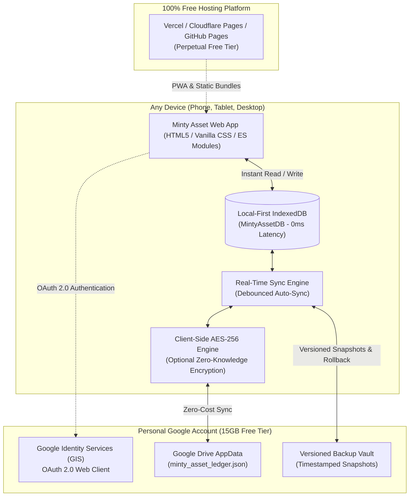

# Minty Asset — Zero-Cost Personal Money Manager & Wealth Tracker

<div align="center">


<p align="center">
  <strong>A high-performance, privacy-first personal finance web application built on an ergonomic 8pt design grid with real-time Google Drive sync, automated versioned backups, and instant point-in-time restore.</strong>
</p>

</div>

---

## 📖 About The Project

**Minty Asset** is an institutional-grade, zero-cost personal finance dashboard designed to solve the three core frustrations of modern money apps: **subscription fees**, **third-party database privacy leaks**, and **complex setup**.

Built on a **Local-First** foundation, Minty Asset commits every transaction, budget, and balance change directly to browser **IndexedDB** in 0 milliseconds with full offline capability. When connected to your personal Google account, changes seamlessly synchronize across your phone, tablet, and PC in real time using your free Google Drive storage (`drive.appdata`), ensuring **zero server costs forever**.

---

## ✨ Key Features

* 💎 **$0.00 / Free Forever**: No monthly subscriptions, no paid database tiers. Uses static hosting and your personal Google account's free 15 GB quota.
* ⚡ **0ms Local-First Responsiveness**: Powered by browser IndexedDB. Instant data loads, zero network latency, and 100% offline functionality.
* 🔄 **Real-Time Cross-Device Sync**: Sign in with Google (OAuth 2.0 / Google Identity Services) to sync transactions across laptop, phone, and tablet without third-party servers.
* 🛡️ **Dual-Layer Versioned Backup Vault**:
  * **Automated Snapshots**: Every state change and daily session creates an immutable point-in-time snapshot.
  * **1-Click Point-in-Time Restore**: Rollback mistakes or inspect past months in one click with automated pre-restore safety checkpoints.
  * **Physical Export**: Download `.json` backup files for cold storage or air-gapped device recovery.
* 📊 **Interactive SVG Data Visualizations**:
  * **Net Worth Pulse**: Total Assets minus Liabilities updated live.
  * **Cash Flow Velocity**: 5-month Income vs. Expense comparative bar chart with interactive tooltips.
  * **Expense Breakdown Donut**: Real-time spending distribution with category color coding and percentage breakdown.
* 🎯 **50/30/20 Budgeting & Category Burn Tracking**: Envelope budgeting with visual thresholds (Green Safe, Amber Warning at 80%, Rose Alert when exceeding budget limits).
* 🔒 **Institutional Privacy & Regulatory Compliance**:
  * **Zero Raw PAN Storage**: PCI DSS 4.0 compliant design (never stores raw credit card numbers or credentials).
  * **Client-Side AES-256-GCM Encryption**: Optional vault passphrase encrypts ledger data in the browser *before* syncing to Google Drive.
  * **GDPR & DPDP Ready**: Self-serve data export (JSON) and complete 1-click database erasure.
* 🎨 **Refined 8pt Design System**:
  * Strict 8pt spatial grid (`4px, 8px, 16px, 24px, 32px, 48px, 64px`) per `ui_ux_design_interface_directive.md`.
  * WCAG 2.2 AA contrast ratios (>= 4.5:1).
  * Smooth dark slate and crisp light mode toggle.
  * Mobile thumb-zone optimization with touch targets >= 44pt.

---

## 🏛️ Architecture Overview



---

## 🚀 Quickstart & Local Development

### Prerequisites
* [Node.js](https://nodejs.org/) v20+ LTS
* [pnpm](https://pnpm.io/) package manager (`npm install -g pnpm`)

### Installation & Run

```bash
# 1. Clone the repository
git clone https://github.com/YOUR_USERNAME/minty-asset.git
cd minty-asset

# 2. Install dependencies via pnpm
pnpm install

# 3. Start local development server
pnpm dev

# 4. Open in browser
# Local:   http://localhost:5173
# Network: http://<your-local-ip>:5173
```

### Production Build & Verification

```bash
# Build production bundle (outputs to dist/)
pnpm build

# Preview production build locally
pnpm preview
```

---

## 🔑 Setting Up Free Google Drive Real-Time Sync (2 Minutes)

To activate cross-device synchronization using your personal Google account:

1. Open the [Google Cloud Console Credentials Page](https://console.cloud.google.com/apis/credentials).
2. Click **Create Credentials** > **OAuth client ID**.
3. Set Application Type to **Web application**.
4. In **Authorized JavaScript origins**, add:
   * `http://localhost:5173`
   * `http://localhost:3000`
   * Your production URL (e.g. `https://your-username.github.io` or `https://minty-asset.vercel.app`)
5. Copy your **Client ID** (e.g. `xxxxxxxxxxxx-xxxxxxxxxxxxxxxx.apps.googleusercontent.com`).
6. In Minty Asset, click the **`Local (Offline)`** pill in the top header or open the **Settings** tab.
7. Paste your Client ID and click **Connect Google Account**.
8. Sign in with Google. All transactions and budgets will now sync across all your devices in real time!

---

## 📦 Project Structure

```
Minty-Asset/
├── .env                  # Sensitive secrets (git-ignored)
├── .env.example          # Safe template for secrets & configuration
├── .gitignore            # Strict exclusions preventing secret leakage
├── index.html            # Semantic, accessible HTML5 layout
├── package.json          # pnpm workflow commands & dependencies
├── README.md             # Project documentation & setup guide
├── css/
│   ├── tokens.css        # 8pt spatial scale, WCAG AA colors, font scale
│   └── main.css          # Glassmorphic layout, tables, cards, responsive rules
├── js/
│   ├── db.js             # IndexedDB local-first database engine
│   ├── crypto.js         # Client-side AES-256-GCM encryption
│   ├── sync.js           # Google Drive AppData & GIS real-time sync engine
│   ├── backup.js         # Versioned backup vault & restore engine
│   ├── ui.js             # SVG charts, donut graphs, tables, and views
│   └── app.js            # App controller, modals, events, theme switcher
```

---

## 📜 License

Distributed under the **MIT License**. Free for personal and commercial use.
